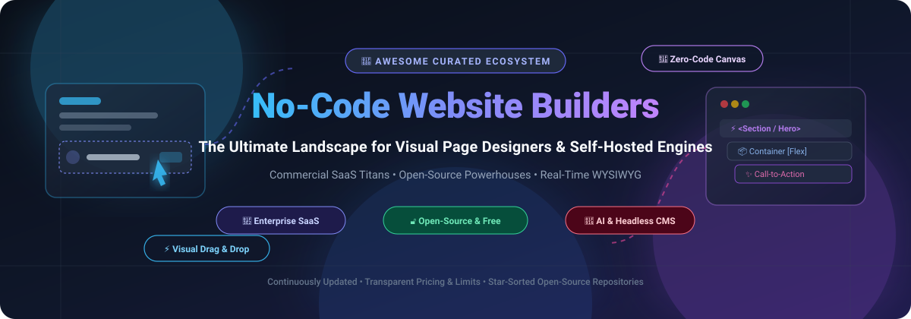

<div align="center">
  
</div>

<h1 align="center">Awesome No-Code Website Builder 🚀</h1>

<p align="center">
  <strong>A curated index of top-tier SaaS platforms, open-source page builders, visual canvas frameworks, and self-hosted website builder software.</strong>
</p>

<p align="center">
  <a href="https://github.com/ishandutta2007/Awesome-No-Code-Website-Builder/stargazers"></a>
  <a href="https://github.com/ishandutta2007/Awesome-No-Code-Website-Builder/network/members"></a>
  <a href="https://github.com/sindresorhus/awesome"></a>
  <a href="https://github.com/ishandutta2007/Awesome-No-Code-Website-Builder/blob/main/LICENSE"></a>
  
</p>

---

## 📌 Table of Contents

- [🌟 Sector Overview & Market Dynamics](#-sector-overview--market-dynamics)
- [🏢 SaaS & Hosted Website Builders](#-saas--hosted-website-builders)
- [🔓 Open-Source GitHub Projects](#-open-source-github-projects)
  - [⭐ Open-Source Visual Builders (Sorted by GitHub Stars)](#-open-source-visual-builders-sorted-by-github-stars)
  - [🧩 Additional Modular Page Builders & Plugins](#-additional-modular-page-builders--plugins)
- [🎯 Selection Guide & Architecture Tradeoffs](#-selection-guide--architecture-tradeoffs)
- [🤝 How to Contribute](#-how-to-contribute)
- [📄 Disclaimer & Security Considerations](#-disclaimer--security-considerations)

---

## 🌟 Sector Overview & Market Dynamics

The global website builder software market size is valued at approximately **$2.6 billion to $3.2 billion** and is projected to expand past **$5.8 billion by 2030** at a compound annual growth rate (CAGR) of **9.5%–10.8%**. 

Market dynamics demonstrate a **moderately consolidated tier at the top, surrounded by high fragmentation at the niche periphery**:
- **Mass-Market & E-Commerce Concentration:** Mega-cap giants (Shopify, Wix, Squarespace/Permira, and WordPress/Automattic) control over 75% of commercial and SMB web creations, creating deep moat advantages through integrated merchant checkouts, hosting infrastructure, and extensive third-party app ecosystems.
- **Visual Design & Agentic Disruption:** A fast-growing challenger segment led by Webflow, Framer, and visual headless engines captures digital agencies, fast-growth startups, and SaaS marketing teams. Concurrently, the emergence of AI code generators and open-source headless page builders (such as GrapesJS, Puck, and TinaCMS) is unbundling visual authoring from proprietary hosting lock-in.

---

## 🏢 SaaS & Hosted Website Builders

The table below lists leading commercial no-code and visual website building platforms, sorted in descending order by company scale (market capitalization, enterprise valuation, or annual recurring revenue).

| Platform 🌐 | Scale / Valuation / Revenue 📊 | Starting Tier Pricing 🏷️ | Free Tier Limits / Trial Specifications 🎁 | Core Strengths 💡 |
|:---|:---|:---|:---|:---|
| **[Shopify Online Store Editor](https://www.shopify.com/)** | **~$110B+ Market Cap** (NYSE: SHOP; >$7.0B Annual Revenue) | **$39/month** (Basic plan, billed monthly; or $29/mo annually) | **3-day free trial**; no credit card required, followed by promotional $1/month for the first month. Full access to visual theme editor and store configuration. | Native section/block storefront builder deeply integrated into enterprise checkout, omnichannel inventory, and payments. |
| **[Squarespace](https://www.squarespace.com/)** | **~$6.9B Acquisition** (Taken private by Permira; >$1.0B ARR) | **$25/month** (Personal plan, billed monthly; or $16/mo annually) | **14-day free trial** with full access to Fluid Engine drag-and-drop builder, designer templates, and custom styling; publishing to live custom domain requires paid upgrade. | Award-winning design aesthetics, unified blogging, scheduling, and portfolio templates powered by the Fluid Engine editor. |
| **[Wix](https://www.wix.com/)** | **~$9.0B–$10.5B Market Cap** (NASDAQ: WIX; >$1.5B Annual Revenue) | **$17/month** (Light plan, billed monthly) | **Free Forever plan available**: Includes Wix-branded subdomain (`username.wixsite.com`), up to 500 MB cloud storage, 500 MB bandwidth, Wix ad banner, and full access to drag-and-drop editor. | Unconstrained free-form visual layout, extensive Wix App Market extensions, and agency-grade Wix Studio workspace. |
| **[Webflow](https://webflow.com/)** | **$4.0B Valuation** (Series C; ~$200M ARR) | **$18/month** (Basic plan, billed monthly; or $14/mo annually) | **Free Starter plan forever**: Includes 2 unhosted staging pages, Webflow staging subdomain (`.webflow.io`), 50 CMS database items, 1 GB asset bandwidth, and full visual CSS canvas. | Clean semantic HTML5/CSS/JavaScript generation, programmatic CMS collections, client-first styling systems, and micro-interactions. |
| **[Framer](https://www.framer.com/)** | **~$1.0B–$1.5B Valuation** (Estimated unicorn status; ~$40M+ ARR) | **$10/month** (Mini plan, billed monthly; or $5/mo annually) | **Free Forever plan**: Allows building and publishing unlimited draft pages on a Framer subdomain (`.framer.media`), supporting up to 1,000 visitors/month, 5 MB asset hosting, with a subtle Framer badge. | Figma-native workflow, motion design animations, real-time AI wireframe generation, and lightning-fast edge hosting. |
| **[Elementor](https://elementor.com/)** | **~$600M–$800M Valuation** (Backing 8M+ active sites; estimated >$80M ARR) | **$59/year** (Essential Plan for 1 site; or ~$9.99/mo for Elementor Hosted) | **Free Core Plugin forever**: Open GPL core installed on any WordPress instance with 40+ basic visual widgets, 30+ templates, and live WYSIWYG front-end editing (excludes Pro theme builder & WooCommerce widgets). | The most dominant visual drag-and-drop ecosystem for WordPress, offering thousands of community extensions and themes. |
| **[Shogun](https://getshogun.com/)** | **~$200M–$300M Valuation** (Acquired by Yotpo / VC backed; >$20M ARR) | **$39/month** (Build plan, billed monthly) | **10-day free trial**: Includes up to 25 published pages, visual drag-and-drop page creation, SEO controls, and Shopify/BigCommerce theme sync. | High-converting landing page creation, native ecommerce element modules, and integrated multi-variant A/B testing. |
| **[PageFly](https://pagefly.io/)** | **~$40M–$60M Valuation** (Bootstrap leader; 200k+ active Shopify merchants) | **$24/month** (Pay-as-you-go starting at 5 slots, billed monthly) | **Free Forever plan**: Grants 1 published page/section slot with full, unrestricted access to all 120+ conversion elements, page types, and 24/7 support. | Dedicated Shopify ecommerce layout builder with granular mobile/tablet responsive customization and zero-bloat code loading. |
| **[GemPages](https://gempages.net/)** | **~$25M–$45M Valuation** (Estimated; 100k+ active online stores) | **$29/month** (Optimize plan, billed monthly; or $23/mo annually) | **Free Forever plan**: Allows creating and publishing 1 live page/section with full drag-and-drop editor access, basic analytics, and AI Image-to-Layout generation credits. | AI-assisted layout creation from screenshots/URLs, high-converting checkout funnels, and sales-boosting widget libraries. |

---

## 🔓 Open-Source GitHub Projects

Explore the best open-source visual page builders, visual CMS frameworks, and self-hostable Webflow/Framer alternatives. Each repository badge links directly to its live stargazers page.

### ⭐ Open-Source Visual Builders (Sorted by GitHub Stars)

| Repository 📦 | GitHub Stars 🌟 | License 📜 | Architecture & Stack 🛠️ | Description & Capabilities 📝 |
|:---|:---:|:---:|:---|:---|
| **[GrapesJS](https://github.com/GrapesJS/grapesjs)** | [](https://github.com/GrapesJS/grapesjs/stargazers) | **BSD-3-Clause** | Vanilla JS / Multi-framework | The industry-standard extensible open-source HTML/CSS visual page builder framework. Powers thousands of internal CMS platforms, email design tools, and visual site creators with zero external dependencies. |
| **[TinaCMS](https://github.com/tinacms/tinacms)** | [](https://github.com/tinacms/tinacms/stargazers) | **Apache-2.0** | Next.js / React / GraphQL / Git | Git-backed headless visual CMS offering real-time contextual page editing directly on your live frontend components with markdown/MDX and JSON data persistence. |
| **[Puck](https://github.com/puckeditor/puck)** | [](https://github.com/puckeditor/puck/stargazers) | **MIT** | React / TypeScript | The self-hosted visual editor for React. Transforms existing React design components into a clean drag-and-drop visual interface with integrated undo/redo, responsive viewports, and clean JSON payloads. |
| **[WordPress Gutenberg](https://github.com/WordPress/gutenberg)** | [](https://github.com/WordPress/gutenberg/stargazers) | **GPL-2.0** | JavaScript / React / PHP | The official block-based editor for the WordPress web ecosystem, enabling full-site editing (FSE), block styling patterns, and modular content authoring. |
| **[Webstudio](https://github.com/webstudio-is/webstudio)** | [](https://github.com/webstudio-is/webstudio/stargazers) | **AGPL-3.0** | Remix / Radix / CSS Variables | The premier open-source Webflow alternative. Connects visually to any headless CMS (Sanity, Strapi, Contentful), supports 100% of standard CSS properties, and exports clean static code to edge networks. |
| **[Instatic](https://github.com/CoreBunch/Instatic)** | [](https://github.com/CoreBunch/Instatic/stargazers) | **GPL-3.0** | Bun / SQLite / QuickJS-WASM | Agentic self-hosted visual CMS developed by the team behind Motion.page. Features in-canvas WYSIWYG editing, baked-to-disk static compilation, and sandboxed WASM plugins. |
| **[Builder.io SDK](https://github.com/BuilderIO/builder)** | [](https://github.com/BuilderIO/builder/stargazers) | **MIT** | React / Vue / Angular / Svelte | Drag-and-drop headless visual CMS engine designed to connect visual page building with custom modern web enterprise codebases and microfrontends. |
| **[Craft.js](https://github.com/prevwong/craft.js)** | [](https://github.com/prevwong/craft.js/stargazers) | **MIT** | React / TypeScript | Modular React framework for building powerful drag-and-drop page builders. Manages editable state trees, drag events, and canvas serialization while leaving UI rendering entirely under your control. |
| **[Elementor Core](https://github.com/elementor/elementor)** | [](https://github.com/elementor/elementor/stargazers) | **GPL-3.0** | PHP / JavaScript / Marionette | The open-source core engine behind the Elementor page builder for WordPress. Provides live visual design interfaces, responsive controls, and modular widget rendering. |
| **[Microweber](https://github.com/microweber/microweber)** | [](https://github.com/microweber/microweber/stargazers) | **MIT** | PHP / Laravel / Live Edit | An open-source, drag-and-drop website builder and CMS with built-in e-commerce shopping cart, multi-language support, and front-end live inline text editing. |
| **[Silex](https://github.com/silexlabs/Silex)** | [](https://github.com/silexlabs/Silex/stargazers) | **AGPL-3.0** | Node.js / GrapesJS / 11ty | A non-profit backed, privacy-first, free alternative to Webflow. Features static site export, GraphQL CMS integration, zero tracking, Docker self-hosting, and an offline desktop application with MCP AI design support. |
| **[Chai Builder](https://github.com/chaibuilder/core)** | [](https://github.com/chaibuilder/core/stargazers) | **MIT** | Next.js / Tailwind CSS | Open-source visual website builder studio for Next.js and Tailwind CSS with AI prompt page generation, custom React component registration, and HTML export. |
| **[Ycode](https://github.com/ycode/ycode)** | [](https://github.com/ycode/ycode/stargazers) | **AGPL-3.0** | Laravel / Vue.js / Tailwind | Open-source visual web development platform and CMS featuring relational databases, responsive canvas layout controls, and authentication layer support. |
| **[OpenPage](https://github.com/buildingopen/openpage)** | [](https://github.com/buildingopen/openpage/stargazers) | **MIT** | React 19 / TypeScript / Tailwind | Modern visual page builder with JSON-first architecture, Gemini AI site generation, and standalone static HTML export. Positioned as a self-hosted alternative to Framer, Lovable, and v0. |

---

### 🧩 Additional Modular Page Builders & Plugins

- 🎨 **[Marfilo](https://alternativeto.net/software/marfilo/about/)** — Free visual drag-and-drop page builder for WordPress (GPL-2.0). Publishes plain lightweight HTML with zero unnecessary script bloat across 95 modular components.
- ⚡ **[PixeBuilder](https://wp-packages.org/packages/wp-plugin/pixebuilder)** — Free in-place visual drag-and-drop page builder plugin for WordPress focused on sub-second rendering speeds.
- 🌐 **[Nitropage](https://www.npmjs.com/package/create-nitropage)** — Self-hostable SolidJS visual builder with Hot Module Replacement (HMR) designed for lightweight landing pages.
- 🛍️ **[Autonnel](https://buildhop.io/discover/autonnel)** — AI-native funnel builder for e-commerce (Apache-2.0); visually crafts dynamic landing, checkout, and upsell funnels connected to open or custom checkouts.

---

## 🎯 Selection Guide & Architecture Tradeoffs

```
                       ┌──────────────────────────────┐
                       │ What are you building?      │
                       └──────────────┬───────────────┘
                                      │
              ┌───────────────────────┴───────────────────────┐
              ▼                                               ▼
   ┌──────────────────────┐                       ┌──────────────────────┐
   │ Fully Hosted SaaS    │                       │ Self-Hosted / Code   │
   └──────────┬───────────┘                       └──────────┬───────────┘
              │                                              │
    ┌─────────┴─────────┐                         ┌──────────┴──────────┐
    ▼                   ▼                         ▼                     ▼
┌───────────────┐ ┌───────────────┐         ┌───────────────┐ ┌───────────────────┐
│ E-Commerce    │ │ Marketing/UI  │         │ React/Next.js │ │ Standalone/Design │
├───────────────┤ ├───────────────┤         ├───────────────┤ ├───────────────────┤
│ • Shopify     │ │ • Webflow     │         │ • Puck        │ │ • Webstudio       │
│ • PageFly     │ │ • Framer      │         │ • TinaCMS     │ │ • Silex           │
│ • GemPages    │ │ • Squarespace │         │ • ChaiBuilder │ │ • GrapesJS        │
│ • Shogun      │ │ • Wix         │         │ • Builder.io  │ │ • OpenPage        │
└───────────────┘ └───────────────┘         └───────────────┘ └───────────────────┘
```

1. **Enterprise E-Commerce Operations:** If you are building a commercial storefront with transactional requirements (payment gateways, dynamic inventory, tax compliance), **Shopify + PageFly / GemPages** provides the highest reliability and conversion capabilities.
2. **High-Fidelity Design Portfolios & Agency Client Work:** **Webflow** and **Framer** represent the gold standard for micro-animations, typography control, and CSS styling without requiring manual code authoring.
3. **Developer-First & Embedded CMS:** If your organization already operates a custom Next.js or React codebase and requires marketing teams to edit layout components safely, adopt **Puck** or **TinaCMS**.
4. **Independent Non-Profit & Self-Hosted Freedom:** For zero subscription fees, complete static file ownership, and complete data privacy, self-host **Webstudio** or **Silex**.

---

## 🤝 How to Contribute

We welcome community contributions, tool submissions, and feature corrections! 

1. **Fork the Repository** 🍴
2. **Create a Feature Branch** (`git checkout -b feature/awesome-addition`)
3. **Add or Update Entries**:
   - Provide the tool name, valid canonical URL, and open-source GitHub link (if applicable).
   - Ensure SaaS additions include verified pricing tiers, exact trial durations/limits, and company scale metrics.
   - For open-source projects, specify the license and verify that it provides visual/drag-and-drop functionality.
4. **Run Format Check & Commit** (`git commit -m "Add <Tool-Name> to No-Code Website Builder ecosystem"`)
5. **Open a Pull Request** 🚀

---

## 📄 Disclaimer & Security Considerations

- This repository is a **community-curated index** provided for educational, architectural, and evaluation purposes. Inclusion does not represent an official endorsement.
- **Security in Visual Builders:** Visual builders handling user-submitted forms or embedded scripts must implement sanitization against Cross-Site Scripting (XSS), maintain Strict Content Security Policies (CSP), and isolate custom iframe environments.
- **Licenses:** Always review software licenses prior to deployment in commercial projects (e.g., AGPL-3.0 for Webstudio/Silex requires source disclosure when modifying the platform, whereas MIT/Apache-2.0 permits closed distribution).

---

<p align="center">
  <sub>Maintained with ❤️ by the open-source community. If you found this list helpful, give it a ⭐️ on GitHub!</sub>
</p>
